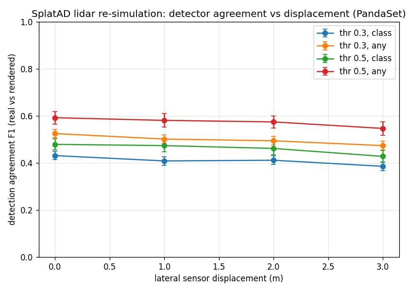
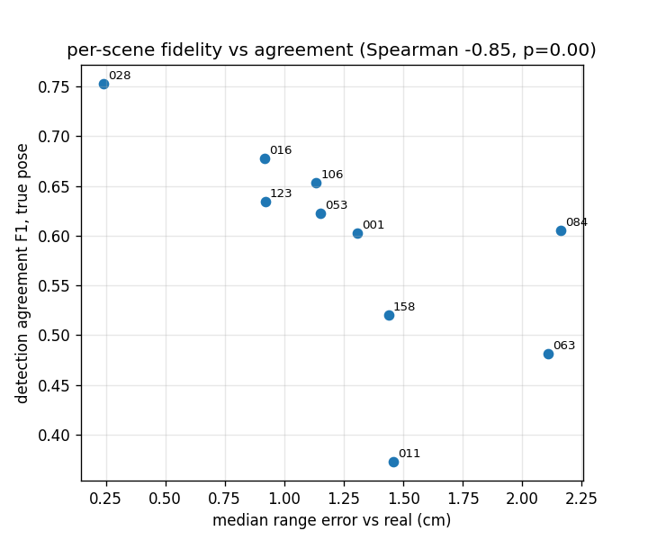
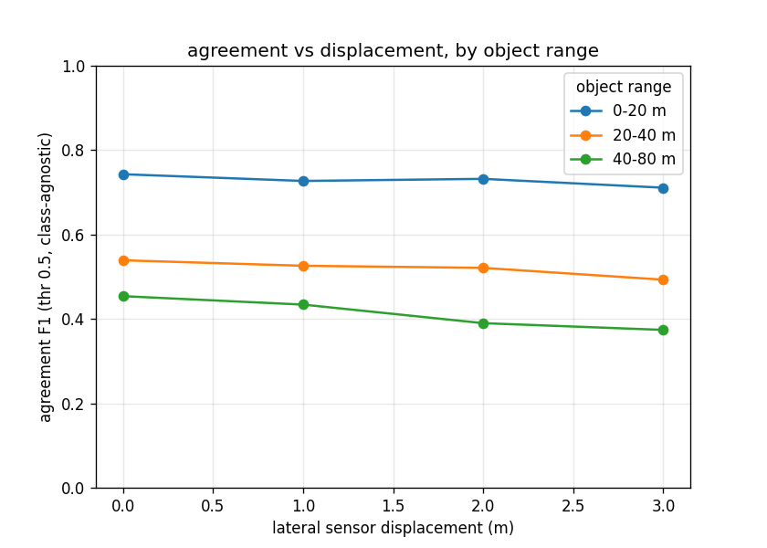

# EchoGap

**Does a 3D detector see the same objects in re-simulated lidar as in the real sweep, and how fast does that agreement fall off when you move the sensor?**

EchoGap is an open, installable benchmark for neural lidar re-simulation. It trains a scene model on a real driving log, renders the lidar sweep again from the original *and from displaced* sensor poses, runs the same off-the-shelf 3D detector on real and rendered sweeps, and reports **detection agreement as a function of sensor displacement**.

Status: v0.1: protocol frozen; results below are from the first full run (PandaSet, SplatAD).

## Why

Lidar re-simulators are scored on rendering metrics (depth error, chamfer, intensity RMSE). Those don't tell you whether a perception stack downstream behaves the same. Detection agreement was introduced for lidar re-sim by LiDARsim (Manivasagam et al., CVPR 2020) and reported by DyNFL (Wu et al., CVPR 2024), but always at the original viewpoints and never as something you can `pip install` and run on open data. On the camera side, "Are NeRFs ready for autonomous driving?" (Lindström et al., CVPR 2024 WAD) measured how detector agreement degrades with lateral shifts; the lidar analog of that curve did not exist. Waabi's "Towards Zero Domain Gap" (ICCV 2023) is the strongest lidar-sim/detector study, on proprietary data.

EchoGap's claim is deliberately narrow: **first open, installable detector-agreement benchmark for lidar re-simulation, and first to measure agreement against viewpoint displacement**, on an ungated CC-BY-4.0 dataset, with splat-based baselines.

## Protocol

| | |
|---|---|
| Data | PandaSet (Pandar64), the 10 sequences used by SplatAD: 001 011 016 028 053 063 084 106 123 158 (HF mirror `georghess/pandaset`, CC-BY-4.0) |
| Scene model | SplatAD (3D Gaussian Splatting with rasterized lidar), 30k iterations per scene, trained with neurad-studio |
| Rendering | every eval scan, re-rendered with the **real scan's beam pattern** from the true pose and from the sensor translated 1 / 2 / 3 m laterally and 1 m up; rendered points are expressed in the original lidar frame so only the viewpoint changes |
| Detector | CenterPoint (pillar, nuScenes-trained, mmdetection3d checkpoint), zero-shot on Pandar64; intensity 0–255 for real and rendered |
| Agreement | detections on the real sweep are the reference; rendered detections are Hungarian-matched by BEV center distance ≤ 2 m (per class, and class-agnostic); we report precision / recall / F1 at score thresholds 0.3 and 0.5, mean over scans with bootstrap 95% CIs |
| Anchor | recall of ground-truth vehicles (PandaSet cuboids) within 50 m on real sweeps, so the detector's absolute quality is visible |

## Results

Run 1: 10 scenes × 10 eval scans × 5 sensor poses = 500 rendered sweeps, 100 real sweeps. Mean over 100 scans per cell, bootstrap 95% CI.

Detection agreement, real vs rendered (class-agnostic, score ≥ 0.5, 2 m center match):

| sensor pose | true pose | +1 m lateral | +2 m lateral | +3 m lateral | +1 m vertical |
|---|---|---|---|---|---|
| **F1** | **0.59** [0.57, 0.62] | 0.58 [0.55, 0.61] | 0.57 [0.55, 0.60] | 0.55 [0.52, 0.58] | 0.53 [0.51, 0.56] |
| precision | 0.74 | 0.72 | 0.72 | 0.67 | 0.68 |
| recall | 0.51 | 0.50 | 0.49 | 0.47 | 0.45 |



Reading it: moving the sensor 3 m sideways costs about 4 F1 points (7% relative); raising it 1 m costs 6, the vertical move hurts more than any lateral one, consistent with the detector's sensitivity to ground-plane height. Rendered detections are precise (0.74 → 0.67) more than they are complete (0.51 → 0.45): the re-simulation rarely invents objects, it drops some. All four threshold/matching variants are in [`results/run1/summary.md`](results/run1/summary.md); the ordering is the same in every one.

**Why isn't the true-pose column 1.0?** Two reasons, now separated. A *noise floor* run perturbs each real sweep by exactly the renderer's measured geometric error (1.2 cm Gaussian range noise) and then also drops 6.5% of points (the renderer's ray-drop rate), and scores the detector against its own output on the untouched sweep:

| perturbation of the real sweep | agreement F1 (score ≥ 0.5, class-agnostic) |
|---|---|
| 1.2 cm range noise | **0.93** [0.92, 0.94] |
| 1.2 cm range noise + 6.5% dropout | **0.91** [0.89, 0.92] |
| SplatAD re-simulation, true pose | 0.59 [0.57, 0.62] |

So a renderer with *only* the measured geometric error and ray-drop rate would score ≈ 0.91; detector flicker explains under 10 F1 points. The remaining ~32 points between 0.91 and 0.59 are things chamfer-style metrics don't see, intensity texture, point-density micro-structure, whole objects going missing. That gap, not the geometry, is what a lidar re-simulator has to close to be trusted for perception testing. (The true-pose scan is also a held-out, interpolated view, so part of the gap is genuine novel-view error.)

### Does rendering fidelity predict downstream agreement?

Yes, across scenes, strongly. Per-scene median range error (from the SplatAD fidelity table) against per-scene agreement at the true pose:



Spearman ρ = **−0.86** (p = 0.002, n = 10 scenes); Kendall τ = −0.73. The best-reconstructed scene (028, 0.24 cm) reaches F1 0.75, the worst (063/084, ~2.1 cm) sit near 0.5–0.6. Ray-drop accuracy correlates too but weaker (ρ = +0.56, p = 0.09). So geometric fidelity is a good *ranking* signal for which scenes a detector will trust, but even the best scene tops out at 0.75, a ceiling that fidelity does not explain (see the noise floor above). Scene 011 is the outlier (1.46 cm, F1 0.37) and is worth a look.

### By object range



| object range | true pose | +3 m lateral | +1 m vertical |
|---|---|---|---|
| 0–20 m | 0.74 | 0.71 | 0.64 |
| 20–40 m | 0.54 | 0.49 | 0.53 |
| 40–80 m | 0.45 | 0.37 | 0.39 |

Near objects agree well and barely care about lateral displacement; far objects agree poorly to begin with and lose the most at 3 m (0.45 → 0.37, 18% relative). The vertical move is the reverse: it hurts *near* objects most (0.74 → 0.64), consistent with the ground-plane sensitivity of pillar-based detectors. Per-cell counts are in [`results/run1/extras.json`](results/run1/extras.json).


Rendering fidelity of the same models (rendered vs real sweep, 100 scans): median range error 1.23 cm, ray-drop accuracy 96.7%, intensity RMSE 0.061, i.e. the reconstructions are as good as the SplatAD paper reports; agreement drops are a viewpoint effect, not a training failure.

Detector anchor (real sweeps, seq 001): 52–60% of ground-truth vehicles within 50 m recovered at score ≥ 0.3, zero-shot from nuScenes.

## Install and run

```bash
pip install -e .
# stage A (needs neurad-studio with get_outputs_for_lidar: see georghess/neurad-studio#93)
echogap-render <config.yml> <scene_id> <out_dir> <max_scans> 0,0,0 0,1,0 0,2,0 0,3,0 0,0,1
# stage B (needs mmdet3d + the CenterPoint nuScenes checkpoint)
echogap-detect <checkpoint.pth> <detections.json> <out_dir>/*.bin
# stage C
echogap-aggregate <out_dir> <detections.json> <results_dir>
```

`scripts/sweep_gilbreth.sbatch` runs all three stages on a SLURM cluster inside the neurad-studio Apptainer image.

## Relation to neurad-studio

Rendering lidar from a trained SplatAD model through the sensor API did not work upstream (issue #75). The fix, a rasterization-based `get_outputs_for_lidar` plus the viewer path, is [PR #93](https://github.com/georghess/neurad-studio/pull/93); EchoGap's stage A calls exactly that method.

## Limitations

- One detector, zero-shot across sensors (nuScenes → Pandar64). Absolute recall is modest; agreement is a relative measure and the anchor row makes that explicit.
- Displacements are pure translations of the sensor with the scan pattern held fixed; rolling-shutter timing is kept from the real sweep.
- Ten scenes from one dataset. Extending to nuScenes / Argoverse 2 is a dataparser away.

## Citation and prior work

LiDARsim (CVPR 2020) · Towards Zero Domain Gap, Waabi (ICCV 2023) · DyNFL (CVPR 2024) · Are NeRFs Ready for Autonomous Driving? (CVPR 2024 WAD) · EUVS (ICCV 2025) · SplatAD (CVPR 2025) · NeuRAD (CVPR 2024)

Apache-2.0.
